README:
# Plataforma de Reservas

## Equipe

- Integrante 1: Vinícius
- Integrante 2: Felipe
- Integrante 3: Nicolas

## Variante

- Variante: Carro
- Regra específica: Um carro só pode ser alugado por uma pessoa de cada vez, devemos utilizar um identificador único para cada veículo.

## Repositório

- URL: https://github.com/Vinny-26/java-project
- Branch: main
- Hash da entrega: a7f5c1931551bb40e7d79c5ac5acfb7e98ea9208

## Diagrama de Classes

```mermaid
---
config:
  theme: dark
  look: neo
---
classDiagram

    class dominio.StatusReserva {
        <<enum>>
        CRIADA
        CANCELADA
        CONCLUIDA
    }

    class dominio.MarcaCarro {
        <<enum>>
        FIAT
        VOLKSWAGEN
        HYUNDAI
        CHEVROLET
        +getNomeExibicao() String
        +possuiModelo(modelo: String) boolean
    }

    class dominio.Identificavel~ID~ {
        <<interface>>
        +getId() ID
    }

    class politica.PoliticaCancelamento {
        <<interface>>
        +calcularEstorno(reserva: dominio.Reserva, momentoCancelamento: LocalDateTime) BigDecimal
    }

    class politica.EstornoTotal {
        +calcularEstorno(reserva: dominio.Reserva, momentoCancelamento: LocalDateTime) BigDecimal
    }

    class politica.EstornoComMulta {
        +calcularEstorno(reserva: dominio.Reserva, momentoCancelamento: LocalDateTime) BigDecimal
    }

    class politica.CalculoPreco {
    <<interface>>
    +calcular(carro: dominio.Carro, periodo: dominio.Periodo) BigDecimal
    }
    
    class politica.PrecoPadrao {
    +calcular(carro: dominio.Carro, periodo: dominio.Periodo) BigDecimal
    }

    class politica.PrecoDescontoLongaDuracao {
    +calcular(carro: dominio.Carro, periodo: dominio.Periodo) BigDecimal
    }

    class dominio.Pessoa {
        -String titular
        -String cpf
        -BigDecimal saldo
        +saldoSuficiente(valor: BigDecimal) boolean
        +debitar(valor: BigDecimal)
        +creditar(valor: BigDecimal)
    }

    class dominio.Carro {
        -String placa
        -String cor
        -boolean arCondicionado
        -BigDecimal valor
        -boolean ativo
        -dominio.MarcaCarro marca
        -String modelo
        +ativar()
        +desativar()
    }

    class dominio.Periodo {
        <<record>>
        +LocalDateTime inicio
        +LocalDateTime fim
        +temSobreposicao(outro: dominio.Periodo) boolean
        +diasDoPeriodo() long
    }

    class dominio.Reserva {
        -int id
        -dominio.StatusReserva status
        -BigDecimal custoTotal
        +getCustoTotal() BigDecimal
        +cancelar(momento: LocalDateTime, politica: politica.PoliticaCancelamento)
        +concluir()
        +restaurar(...) dominio.Reserva$
    }

    class repositorio.Repositorio~T, ID~ {
    <<interface>>
    +salvar(entidade: T)
    +buscarPorId(id: ID) Optional~T~
    +listarTodos() List~T~
    +deletarPorId(id: ID)
    }

    class repositorio.RepositorioMemoria~T, ID~ {
    -Map~ID, T~ mapa
    +salvar(entidade: T)
    +buscarPorId(id: ID) Optional~T~
    +listarTodos() List~T~
    +deletarPorId(id: ID)
    }

    class repositorio.PersistenciaJsonServico {
    -ObjectMapper objectMapper
    +salvar(caminho: Path, reservas: List~dominio.Reserva~)
    +restaurar(caminho: Path) List~dominio.Reserva~
    }
    
    class servico.ReservaServico {
    -repositorio.Repositorio~dominio.Reserva, Integer~ repositorio
    +criarReserva(id: int, periodo: dominio.Periodo, pessoa: dominio.Pessoa, carro: dominio.Carro) dominio.Reserva
    +criarReserva(id: int, periodo: dominio.Periodo, pessoa: dominio.Pessoa, carro: dominio.Carro, calculoPreco: politica.CalculoPreco) dominio.Reserva
    }
    
    class servico.ConsultaReservaServico {
    -repositorio.Repositorio~dominio.Reserva, Integer~ repositorio
    +buscarReservaPorStatus(status: dominio.StatusReserva) List~dominio.Reserva~
    +buscarReservaPorCPF(cpf: String) List~dominio.Reserva~
    +buscarReservaPorMarcaCarro(marca: dominio.MarcaCarro) List~dominio.Reserva~
    +calcularFaturamentoConcluido() BigDecimal
    +carroPossuiReservaAtiva(placa: String) boolean
    +contarReservasPorStatus(status: dominio.StatusReserva) long
    +agruparTotalReservasPorStatus() Map~dominio.StatusReserva, Long~
    +listarReservasOrdenadasPorDataInicio() List~dominio.Reserva~
    +listarReservasOrdenadasPorCustoDecrescente() List~dominio.Reserva~
    }

    class app.Main {
    +main(args: String[])$
    }

    dominio.Identificavel~Integer~ <|.. dominio.Reserva : implementa
    politica.PoliticaCancelamento <|.. politica.EstornoTotal : implementa
    politica.PoliticaCancelamento <|.. politica.EstornoComMulta : implementa
    politica.CalculoPreco <|.. politica.PrecoPadrao : implementa
    politica.CalculoPreco <|.. politica.PrecoDescontoLongaDuracao : implementa
    repositorio.Repositorio~T, ID~ <|.. repositorio.RepositorioMemoria~T, ID~ : implementa

    dominio.Reserva "1" *-- "1" dominio.Periodo : composição
    dominio.Reserva "0..*" --> "1" dominio.Pessoa : responsável
    dominio.Reserva "0..*" --> "1" dominio.Carro : recurso
    dominio.Reserva "1" --> "1" dominio.StatusReserva : estado
    dominio.Reserva ..> politica.PoliticaCancelamento : usa
    dominio.Reserva ..> politica.CalculoPreco : usa 
    dominio.Carro "0..*" --> "1" dominio.MarcaCarro : marca
    servico.ReservaServico --> repositorio.Repositorio~dominio.Reserva, Integer~ : coordena
    servico.ConsultaReservaServico --> repositorio.Repositorio~dominio.Reserva, Integer~ : consulta
    repositorio.PersistenciaJsonServico ..> dominio.Reserva : restaura
    app.Main ..> servico.ReservaServico : executa
    app.Main ..> servico.ConsultaReservaServico : executa
    app.Main ..> repositorio.PersistenciaJsonServico : executa
```



## Requisitos atendidos

1. Cadastro e validação de entidades e objetos de valor (RF1, RF2, RF3): Implementação de dominio.Pessoa, dominio.Carro 
(com enum MarcaCarro e status ativo/inativo) e dominio.Periodo (record imutável com validação de intervalo e detecção de sobreposição).
2. Criação de reservas e proteção contra conflitos de agenda (RF4 e Invariante 4): Coordenação via servico.ReservaServico impedindo IDs duplicados,
veículos inativos, saldo insuficiente e sobreposição de períodos ativos (CRIADA) para o mesmo carro.
3. Máquina de estados e ciclo de vida (RF5): Controle rigoroso das transições CRIADA -> CONCLUIDA e CRIADA -> CANCELADA,
bloqueando transições inválidas ou repetidas com EstadoInvalidoException.
4. Políticas polimórficas de cancelamento e precificação (RF6 e RF7): Aplicação do padrão Strategy com PoliticaCancelamento (EstornoTotal e EstornoComMulta)
e CalculoPreco (PrecoPadrao e PrecoDescontoLongaDuracao com 10% de desconto a partir de 7 dias), usando BigDecimal em todas as operações financeiras.
5. Repositório genérico, consultas, ordenações e relatórios sintéticos (RF8 e RF10): Persistência em memória via RepositorioMemoria<T, ID>
e consultas funcionais com Java Streams em ConsultaReservaServico (filtros por status, CPF e marca; ordenação por data de início e custo; faturamento concluído e agrupamento por status).
6. Persistência e restauração segura em JSON (RF9 e Invariante 8): Serialização e desserialização UTF-8 via Jackson em PersistenciaJsonServico,
revalidando todas as invariantes na leitura por meio de Reserva.restaurar(...) (@JsonCreator) sem duplicar cobranças no saldo do cliente.
7. Demonstração executável e suíte automatizada JUnit 5: Classe app.Main executável via Maven e cobertura completa de testes unitários e de integração em todas as camadas.

## Suíte completa de testes

No Linux/macOS:

```bash
./mvnw clean test
```

No Windows:

```powershell
.\mvnw.cmd test
```

## Demonstração completa via terminal

No Linux/macOS:

```bash
./mvnw compile exec:java -Dexec.mainClass="app.Main"
```

No Windows:

```powershell
.\mvnw.cmd compile exec:java "-Dexec.mainClass=app.Main"
```

## Estrutura
```
├── docs/
│   ├── decisoes.md                           # Registro cronológico de decisões arquiteturais
│   └── diagrama-de-classes.md                # Diagrama de classes completo
│   └── IA_USAGE.md                           # Uso de IA documentado pelos integrantes do grupo
│   └── README.md                             # Estrutura e orientações sobre o projeto completo
├── src/
│   ├── main/java/
│   │   ├── app/
│   │   │   └── Main.java                     # Fluxo executável de demonstração via terminal
│   │   ├── dominio/
│   │   │   ├── Carro.java                    # Entidade veículo e regras de disponibilidade
│   │   │   ├── Identificavel.java            # Contrato genérico de identificação
│   │   │   ├── MarcaCarro.java               # Enumeração das marcas suportadas
│   │   │   ├── Periodo.java                  # Record imutável de intervalo temporal
│   │   │   ├── Pessoa.java                   # Entidade cliente e operações financeiras
│   │   │   ├── Reserva.java                  # Entidade reserva, máquina de estados e @JsonCreator
│   │   │   └── StatusReserva.java            # Estados da reserva (CRIADA, CONCLUIDA, CANCELADA)
│   │   ├── excecoes/
│   │   │   ├── CreditosInsuficienteException.java  # Exceção para operação de crédito inválida
│   │   │   ├── DadosInvalidosException.java  # Exceção para parâmetros ou invariantes inválidas
│   │   │   └── DominioException.java         # Exceção para erros de domínio
│   │   │   └── EstadoInvalidoException.java  # Exceção para estado invalido dos objetos
│   │   │   └── SaldoInsuficienteException.java  # Exceção para transições com saldo insuficiente
│   │   │   └── SobreposicaoPeriodoException.java  # Exceção para sobreposições de período
│   │   ├── politica/
│   │   │   ├── CalculoPreco.java             # Interface Strategy de precificação
│   │   │   ├── PrecoPadrao.java              # Estratégia de tarifa padrão
│   │   │   ├── PrecoDescontoLongaDuracao.java# Estratégia com desconto para >= 7 dias
│   │   │   ├── PoliticaCancelamento.java     # Interface Strategy de estorno
│   │   │   ├── EstornoTotal.java             # Estratégia de estorno integral
│   │   │   └── EstornoComMulta.java          # Estratégia de estorno com multa (< 48h)
│   │   ├── repositorio/
│   │   │   ├── Repositorio.java              # Contrato genérico de armazenamento
│   │   │   ├── RepositorioMemoria.java       # Implementação em memória baseada em Map
│   │   │   └── PersistenciaJsonServico.java  # Persistência e restauração JSON (UTF-8)
│   │   └── servico/
│   │       ├── ReservaServico.java           # Criação de reservas com bloqueio de sobreposição
│   │       └── ConsultaReservaServico.java   # Filtros, ordenações e agregações via Streams
│   └── test/java/                            # Testes unitários e de integração JUnit 5
├── pom.xml                                   # Configuração Maven, Jackson e JUnit 5
```
