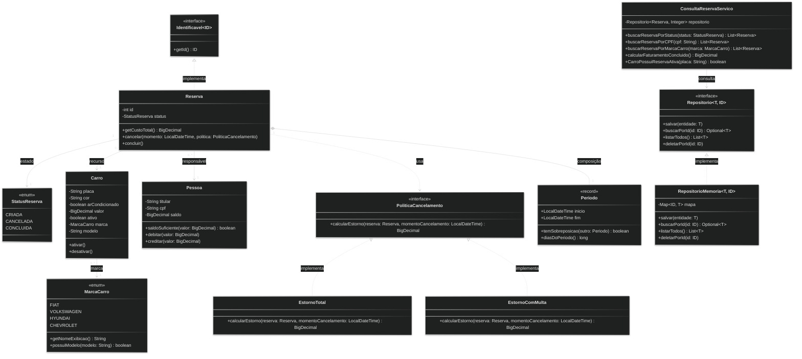

README:
# Plataforma de Reservas

## Equipe

- Integrante 1: Vinícius
- Integrante 2: Felipe
- Integrante 3: Nicolas

## Variante

- Variante: Carro
- Regra específica: Um carro só pode ser alugado por uma pessoa de cada vez, devemos utilizar um identificador único para cada veículo.

## Repositório

- URL: https://github.com/Vinny-26/java-project
- Branch: main
- Hash da entrega: ed65e2bb99845a6eeaec03438a19a7da8c7d170e

## Diagrama de Classes



## Requisitos atendidos

1. Classes iniciais e métodos implementadas
2. Método Equals reimplementado nas classes Carro e Pessoa
3. Testes feitos e validados em todas as classes e Record

Atualize esta seção em cada marco do projeto.

## Como executar

```bash
./mvnw test
```

No Windows:

```powershell
.\mvnw.cmd test
```

## Estrutura
As classes de domínio serão criadas pela equipe depois da escolha da variante.
Não adicione camadas, interfaces ou padrões antes de existir um requisito que
justifique a decisão.
