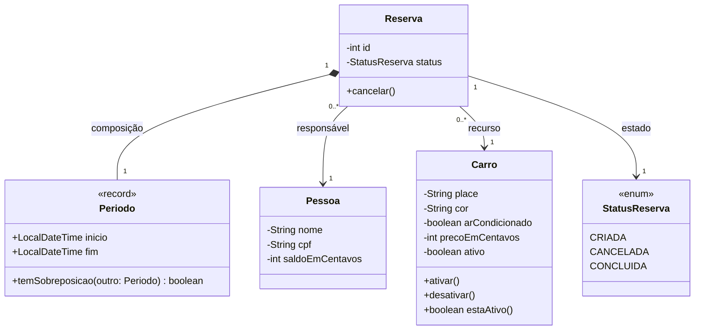

README:
# Plataforma de Reservas

## Equipe

- Integrante 1: Vinícius
- Integrante 2: Felipe
- Integrante 3: Nicolas

## Variante

- Variante: Veículos
- Regra específica: Um veículo só pode ser alugado por uma pessoa de cada vez, devemos utilizar um identificador único para cada veículo.

## Diagrama de Classes



## Requisitos atendidos
Adicione um "OK" sempre que um requisito for atendido!
1. Implementar classe veículo com restrições seguras(identificador único imutável)
2. Sobrescrever método Equals e testar
3. Estruturar métodos necessários. (Reserva, Pagamento, fimReserva)

Atualize esta seção em cada marco do projeto.

## Como executar

```bash
./mvnw test
```

No Windows:

```powershell
.\mvnw.cmd test
```

## Estrutura

As classes de domínio serão criadas pela equipe depois da escolha da variante.
Não adicione camadas, interfaces ou padrões antes de existir um requisito que
justifique a decisão.
